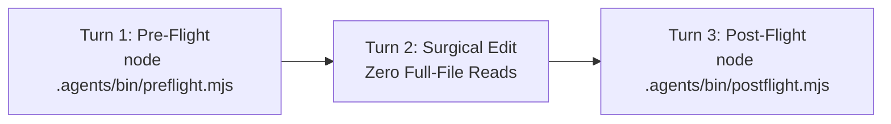

# Neural Orchestra v5.3 - Fast-Path Execution Protocol

> **For Antigravity Default Agent & Direct Developer Operations**
> Operating without Conductor? Follow this deterministic 3-turn protocol to achieve zero-latency execution, zero token waste, and 100% quality gate compliance.

---

## The 3-Turn Fast-Path Protocol



### Turn 1: Unified Pre-Flight Discovery (<40ms)
Before reading any files or writing code, run the unified pre-flight command in a single terminal call. **NEVER run `read_file` or `grep` before `preflight.mjs`:**

```bash
node .agents/bin/preflight.mjs --task "<user request or feature description>" [--file "<target file>"] [--role "<role>"]
```

**What Pre-Flight Provides in 1 Output:**
1. **[1] PROJECT DNA**: Tech stack, test/typecheck commands, and directory ownership mapping.
2. **[2] ACTIVE MICRO-SKILLS**: The 1–3 exact micro-skill shards (<90 lines) needed for this specific task.
3. **[3] DELTA SYMBOL MAP**: Matching `[STUB]` symbols (implement these exact line numbers) and `[DONE]` exported signatures with line ranges (never read `[DONE]` bodies into context).

---

### Turn 2: Surgical Code Modification OR Parallel Worker Dispatch
Start coding immediately on Turn 2 using the line numbers and signatures provided in the Delta Manifest.

- **For Tasks Touching `<= 3` Files (Surgical Mode):**
  - Use `node .agents/bin/code-query.mjs slice <file> <startLine> <endLine>` or `symbol <name>` to inspect only target `[STUB]` lines.
  - Never read `[DONE]` function bodies into LLM context.
  - Apply surgical edits using line-based replacement.
- **For Tasks Touching `> 3` Files Across Modules (Parallel Worker Pool Mode):**
  - Partition work across disjoint file buckets:
    ```bash
    node .agents/bin/orchestra-state.mjs partition-workers --max-clones 4
    ```
  - Dispatch parallel role clones with strictly isolated `allowedWritePaths` (blocking `.agents/**`) to eliminate merge conflicts.
- **Strict Prohibition**: Full-file re-reads (`read_file` on entire source files) are FORBIDDEN.

---

### Turn 3: Single Post-Flight Verification (<1s)
After making edits, run the unified post-flight command before declaring complete:

```bash
node .agents/bin/postflight.mjs [--role "<role>"] [--worker "<workerId>"]
```

**Automated Validations:**
- Incremental AST Symbol Re-Indexing (`.agent_execution/cache/symbol-registry.json`).
- Worker Boundary Check (if `--worker` provided, verifies changes stay within `allowedWritePaths`).
- Git merge conflict marker scan (`<<<<<<<`, `=======`, `>>>>>>>`).
- Project TypeScript / compiler typecheck (`tsc --noEmit`, `cargo check`, etc.).
- UI craft static rules (no hardcoded hex colors, no `any`, no emojis in action labels).
- Engine Immutability Check (`.agents/` remains 100% untouched).
- Dependency security audit.

> [!IMPORTANT]
> The post-flight command must report `PASS (0 violations)` before you declare the task complete.

---

## Core Operational Rules

1. **Engine Immutability**: `.agents/` is strictly READ-ONLY. Never create, modify, or delete files inside `.agents/` during project execution. All caches, registries, and reports reside in `.agent_execution/`.
2. **Task-Scoped JIT Shards**: Skill guidance is delivered via compact micro-shards (`.agents/skills/shards/*.md`, 15–20 lines each). Do not load legacy monolithic skill manuals.
3. **AST Type Skeletons**: To generate or inspect the complete type skeleton of a project:
   ```bash
   node .agents/bin/code-query.mjs skeleton
   ```
