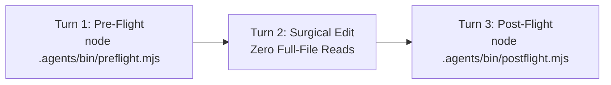

# Neural Orchestra v5.3 - Fast-Path Execution Protocol

> **For Antigravity Default Agent & Direct Developer Operations**
> Operating without Conductor? Follow this deterministic 3-turn protocol to achieve zero-latency execution, zero token waste, and 100% quality gate compliance.

---

## The 3-Turn Fast-Path Protocol



### Turn 1: Unified Pre-Flight Discovery (<40ms)
Before reading any files or writing code, run the unified pre-flight command in a single terminal call:

```bash
node .agents/bin/preflight.mjs --task "<user request or feature description>" [--file "<target file>"]
```

**What Pre-Flight Provides in 1 Output:**
1. **Project DNA**: Tech stack, primary languages, frameworks, package manager, test runners.
2. **File Responsibility**: Primary assigned role and file ownership mapping.
3. **Task-Scoped Micro-Skills**: The 1–3 exact micro-skill shards (from `.agents/skills/shards/*.md`) needed for the task.
4. **AST Delta Manifest**:
   - `[STUB/PENDING]` symbols requiring implementation.
   - `[DONE]` symbol signatures with exact start/end line numbers.

---

### Turn 2: Surgical Code Modification
Start coding immediately on Turn 2 using the line numbers and signatures provided in the Delta Manifest.

- **FORBIDDEN**: Reading entire source files into context (`read_file` on large files).
- **ALLOWED**:
  - Direct file editing via `edit_file` / `write_file`.
  - Surgical line slicing when extra context is needed:
    ```bash
    node .agents/bin/code-query.mjs slice <file> <startLine> <endLine>
    node .agents/bin/code-query.mjs symbol <symbolName>
    ```

---

### Turn 3: Post-Flight Verification (<1s)
After making edits, run the unified post-flight command:

```bash
node .agents/bin/postflight.mjs
```

**Automated Validations:**
- Incremental AST Symbol Re-Indexing (`.agent_execution/cache/symbol-registry.json`).
- Git merge conflict marker scan (`<<<<<<<`, `=======`, `>>>>>>>`).
- Project TypeScript / compiler typecheck (`tsc --noEmit`, `cargo check`, etc.).
- UI craft static rules (no hardcoded hex colors, no `any`, no emojis in action labels).
- Engine Immutability Check (`.agents/` remains 100% untouched).
- Dependency security audit.

> [!IMPORTANT]
> The post-flight command must report `PASS (0 violations)` before you declare the task complete.

---

## Core Operational Rules

1. **Engine Immutability**: `.agents/` is strictly READ-ONLY. Never create, modify, or delete files inside `.agents/` during project execution. All caches, registries, and reports reside in `.agent_execution/`.
2. **Task-Scoped JIT Shards**: Skill guidance is delivered via compact micro-shards (`.agents/skills/shards/*.md`, 15–20 lines each). Do not load legacy monolithic skill manuals.
3. **AST Type Skeletons**: To generate or inspect the complete type skeleton of a project:
   ```bash
   node .agents/bin/code-query.mjs skeleton
   ```
