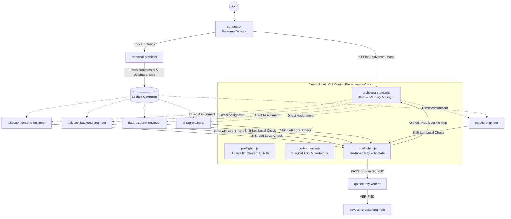

# 🏢 AgenticDev: Autonomous AI Software Company Framework

> An **enterprise-grade, production-ready autonomous multi-agent software engineering company** built for [Google Antigravity (AGY)](https://antigravity.dev).
> Powered by **Neural Orchestra v5**: Zero-Token Deterministic Control Plane, 8 Macro Vertical Engineers, and Contract-First AST Context.

[](#-active-agent-roster)
[](#-zero-token-deterministic-control-plane-agentsbin)
[](#-skills--sub-roles-library)
[](#-workflows)
[](#-architecture-overview)
[](./LICENSE)

---

## 📋 Table of Contents

- [What's New in Neural Orchestra v5](#-whats-new-in-neural-orchestra-v5)
- [Zero-Token Deterministic Control Plane (`.agents/bin/`)](#-zero-token-deterministic-control-plane-agentsbin)
- [Anti-MCP Freeze & Bounded Tool Execution Architecture](#-anti-mcp-freeze--bounded-tool-execution-architecture)
- [Contract-First AST Skeletons](#-contract-first-ast-skeletons)
- [Architecture Overview](#-architecture-overview)
- [Active Agent Roster (1 Entry Point + 8 Macro Verticals)](#-active-agent-roster)
- [Prompt Caching Architecture](#-prompt-caching-architecture)
- [Skills & Sub-Roles Library](#-skills--sub-roles-library)
- [Workflows (Contract-First Vertical Slicing)](#-workflows)
- [Backward Compatibility & Deprecation Map](#-backward-compatibility--deprecation-map)
- [Quick Start](#-quick-start)

---

## ⚡ What's New in Neural Orchestra v5

Neural Orchestra v5 completely refactors the multi-agent system from **58 horizontal micro-agents + 6 LLM managers** down to **1 Ultra-Thin Entry Point + 8 Macro Vertical Engineers + Zero-Token CLI Control Plane**.

### Solved: The Multi-Agent Coordination Tax
- **Zero-Token Control Plane**: Replaced LLM manager agents (`execution-manager`, `context-manager`, `memory-manager`, `resource-manager`) with fast (<5ms), zero-dependency Node.js CLI tools in `.agents/bin/`.
- **Anti-MCP Freeze Architecture**: Eliminated background daemon loops (e.g. polling `event-queue.jsonl`) and hanging MCP stdio calls. Replaced them with bounded, timeout-enforced CLI scripts (hard 30s timeout, `SIGKILL` on hang, 8KB buffer truncation to prevent deadlocks).
- **Contract-First Vertical Slicing**: Rather than horizontally passing files across 5-6 micro-workers (routing → state → UI → tests), a single **Macro Vertical Engineer** owns the entire vertical slice against locked executable TypeScript contracts (`contracts.ts`).
- **Prompt Caching Structure**: System role prompts are partitioned into a static prefix (role + skills + contracts) for 100% LLM cache hits, and a dynamic suffix for task-specific instructions.

---

## 🛠️ Zero-Token Deterministic Control Plane (`.agents/bin/`)

Instead of burning tokens on LLMs to read/write JSON states, the control plane executes deterministically in pure Node.js:

### 1. `preflight.mjs` & `code-query.mjs` (Unified Discovery & AST Skeletons)
- **Path**: [`.agents/bin/preflight.mjs`](file:///C:/Users/maxxc/Desktop/agenticdev/.agents/bin/preflight.mjs), [`.agents/bin/code-query.mjs`](file:///C:/Users/maxxc/Desktop/agenticdev/.agents/bin/code-query.mjs)
- **Languages**: `.ts`, `.tsx`, `.js`, `.jsx`, `.py`, `.dart`, `.rs`, `.c`, `.cpp`, `.cs`, `.java`, `.go`
- **Functionality**: `preflight.mjs` executes incremental onboarding, multi-language AST indexing, and micro-skill shard loading in <40ms. Skeletons can be generated on demand via `code-query.mjs skeleton`.
- **Efficiency**: Generates [`context-skeleton.d.ts`](file:///C:/Users/maxxc/Desktop/agenticdev/context-skeleton.d.ts), achieving **~85% to 97% token reduction** with zero hallucination.

```bash
node .agents/bin/preflight.mjs --task "implement user auth"
node .agents/bin/code-query.mjs skeleton src/
```

### 2. `quality-gate.mjs` (Quality-Manager & Conflict-Resolver Replacement)
- **Path**: [`.agents/bin/quality-gate.mjs`](file:///C:/Users/maxxc/Desktop/agenticdev/.agents/bin/quality-gate.mjs)
- **Execution**: Shift-left deterministic CLI enforcement with **30,000ms hard timeout** (`SIGKILL` on hang) and **8KB max buffer truncation** to prevent deadlocks.
- **Automated Checks**:
  1. **Git Conflict Markers**: Scans workspace for `<<<<<<< HEAD`, `=======`, and `>>>>>>>`.
  2. **TypeScript / Linter Check**: Runs `tsc --noEmit` or configured project lint/typecheck scripts with exact line/column error extraction.
  3. **`professional-ui-craft` Static Enforcement**:
     - Bans hardcoded hex colors (`#xxxxxx`) in UI files.
     - Bans `any` types in TypeScript/Dart.
     - Bans emojis in functional UI labels and buttons (Lucide/Phosphor icons required).
     - Bans arbitrary rainbow gradients and z-index magic numbers (`z-[9999]`).
     - Enforces `ErrorBoundary` presence in application route trees.
  4. **Dependency Health Check**: High/critical CVE audit via `npm audit --audit-level=high`.
- **Output**: Writes structured pass/fail report to `.agent_execution/quality-gate-report.json`.

```bash
node .agents/bin/quality-gate.mjs
```

### 3. `orchestra-state.mjs` (Execution, Memory & Resource Manager Replacement)
- **Path**: [`.agents/bin/orchestra-state.mjs`](file:///C:/Users/maxxc/Desktop/agenticdev/.agents/bin/orchestra-state.mjs)
- **Features**:
  - **State Transitions**: Manages `.agent_execution/project-plan.json` milestones and task states.
  - **Deterministic Anti-Bloat Caps (<5ms)**: Strictly caps `error-registry.json` at **max 20 items** (LRU + frequency sorting) and agent memory at **max 15 items** per agent.
  - **Automated Failure Mapping**: Reads `quality-gate-report.json`, cross-references `.agent_execution/file-responsibility-index.json`, and automatically maps broken files directly to the responsible Macro Vertical Agent (`.agent_execution/failure-assignments.json`).
  - **Atomic File I/O**: Writes files via `.tmp` before renaming to prevent race conditions and file deadlocks between parallel workers.

```bash
node .agents/bin/orchestra-state.mjs init-plan --name "MyProject" --workflow software-project
node .agents/bin/orchestra-state.mjs map-failures
node .agents/bin/orchestra-state.mjs prune-memory
```

---

## 🔒 Anti-MCP Freeze & Bounded Tool Execution Architecture

In multi-agent systems, background daemons and MCP tool calls frequently freeze due to unbounded stdio buffers, deadlocked file locks, and stateful background polling loops.

Neural Orchestra v5 eliminates these failure modes:
1. **No Background Daemons**: The asynchronous `memory-manager` loop polling `event-queue.jsonl` is removed. Memory and error records are pruned synchronously in `<5ms` via `orchestra-state.mjs`.
2. **Hard Timeouts (`SIGKILL`)**: Every CLI execution is bounded by a strict `30000ms` timer. If a child process hangs or waits for interactive input, it is terminated immediately with `SIGKILL` (or `taskkill /F /T` on Windows).
3. **8KB Buffer Truncation**: Stdout and stderr streams cap memory retention at 8KB, preventing Node.js stream deadlocks (`E2BIG` / buffer exhaustion).
4. **Atomic File Swapping**: Parallel workers never read half-written JSON files. State updates are written to an isolated temporary PID file and atomically renamed.

---

## 📐 Contract-First AST Skeletons

Instead of passing multi-thousand line prose files (`architecture.json`, `api-contract.json`), the Principal Architect produces **real executable code contracts**:

```
src/contracts/
├── contracts.ts          # Shared TypeScript interfaces, DTOs & Zod schemas
└── ...
prisma/
└── schema.prisma         # Relational database models and constraints
.env.example              # Typed environment variables and defaults
```

Both `fullstack-backend-engineer` and `fullstack-frontend-engineer` import directly from `contracts.ts`. Because types and Zod schemas are locked in Phase 1, frontend and backend development runs **simultaneously in parallel** with zero integration friction.

---

## 🏛️ Architecture Overview



---

## 👥 Active Agent Roster

The active roster consists of **1 Ultra-Thin Entry Point + 8 Macro Vertical Engineers**:

| Agent | Scope & Ownership | Core Skills & Sub-Roles |
|---|---|---|
| [`conductor`](file:///C:/Users/maxxc/Desktop/agenticdev/.agents/agents/conductor/agent.md) | Supreme Director & Entry Point. Drives control plane CLI, dispatches vertical slices, and handles UX escalation relays. | `software-project-management` |
| [`principal-architect`](file:///C:/Users/maxxc/Desktop/agenticdev/.agents/agents/principal-architect/agent.md) | Technical intake, executable code contracts (`contracts.ts`, Zod schemas, OpenAPI specs), and system boundaries. | `architecture-design`, `api-design`, `code-contracts`, `intake-interview` |
| [`fullstack-frontend-engineer`](file:///C:/Users/maxxc/Desktop/agenticdev/.agents/agents/fullstack-frontend-engineer/agent.md) | Entire UI vertical slices: UI/UX visual craft, accessible components, client state, routing, API client integration, and unit tests. | `frontend-development`, `react-patterns`, `professional-ui-craft`, `typescript-patterns`, `localization` |
| [`fullstack-backend-engineer`](file:///C:/Users/maxxc/Desktop/agenticdev/.agents/agents/fullstack-backend-engineer/agent.md) | Entire backend vertical slices: HTTP route controllers, auth/RBAC, domain business services, data access, caching, and rate limiting. | `backend-development`, `api-design`, `typescript-patterns`, `security-review`, `analytics-tracking` |
| [`data-platform-engineer`](file:///C:/Users/maxxc/Desktop/agenticdev/.agents/agents/data-platform-engineer/agent.md) | Database schemas, reversible migrations (UP/DOWN), indexing strategies, representative seed data, and query optimization. | `database-engineering`, `schema-design`, `migrations`, `seed-data`, `query-optimization` |
| [`ai-rag-engineer`](file:///C:/Users/maxxc/Desktop/agenticdev/.agents/agents/ai-rag-engineer/agent.md) | LLM provider integrations, structured output generation, RAG document pipelines, semantic chunking, and vector database indexing. | `ai-ml-engineering`, `llm-config`, `rag-pipeline`, `vector-database` |
| [`mobile-engineer`](file:///C:/Users/maxxc/Desktop/agenticdev/.agents/agents/mobile-engineer/agent.md) | Flutter and React Native cross-platform applications, touch-optimized screens, mobile state management, offline storage, and push notifications. | `flutter-development`, `mobile-notifications`, `localization`, `offline-storage` |
| [`qa-security-verifier`](file:///C:/Users/maxxc/Desktop/agenticdev/.agents/agents/qa-security-verifier/agent.md) | Triggered ONLY after `quality-gate.mjs` passes. Executes E2E journeys, security audits, stress testing, and reviews git diff. | `testing`, `security-review`, `code-review`, `load-testing`, `e2e-browser-testing` |
| [`devops-release-engineer`](file:///C:/Users/maxxc/Desktop/agenticdev/.agents/agents/devops-release-engineer/agent.md) | Production Docker containerization, CI/CD pipelines, runtime observability (`/health`, `/ready`, logs, metrics), and release packaging. | `devops-practices`, `observability`, `git-integration`, `docker-containers`, `ci-cd-pipelines` |

---

## ⚡ Prompt Caching Architecture

All 8 Macro Vertical Engineers are structured to take full advantage of **Prompt Caching** (prefix caching supported by Google Gemini, Claude, and OpenAI):

```markdown
<!-- [PROMPT_CACHING_STATIC_PREFIX_START] -->
# System Role: <Macro Vertical Engineer>
## Persona & Mission
## Static Skills & Sub-Role References
## Engineering Standards
## Shift-Left Deterministic Quality Gate
<!-- [PROMPT_CACHING_STATIC_PREFIX_END] -->

---

<!-- [DYNAMIC_TASK_INSTRUCTIONS_START] -->
## Dynamic Task Execution
[Task assignments and vertical slice parameters injected here]
<!-- [DYNAMIC_TASK_INSTRUCTIONS_END] -->
```

The top 80% of the prompt remains completely static across requests, allowing language model engines to serve responses with near-zero latency and massive token discounts.

---

## 📚 Skills & Sub-Roles Library

All **23 Core Skill Guides** in `.agents/skills/` are fully preserved:
`agy-customizations`, `ai-ml-engineering`, `analytics-tracking`, `antigravity-guide`, `api-design`, `architecture-design`, `backend-development`, `code-review`, `database-engineering`, `devops-practices`, `flutter-development`, `frontend-development`, `git-integration`, `load-testing`, `localization`, `mobile-notifications`, `observability`, `performance-optimization`, `professional-ui-craft`, `react-patterns`, `security-review`, `software-project-management`, `testing`, `typescript-patterns`, `uiux-design`.

In addition, **33 Modular Sub-Role Checklists** in `.agents/skills/sub-roles/` contain the specialized checklist instructions migrated from the previous micro-workers:
- `frontend/`: `ui-components.md`, `state-management.md`, `routing.md`, `api-integration.md`, `accessibility.md`, `localization.md`, `performance.md`
- `backend/`: `api-routes.md`, `auth-rbac.md`, `business-logic.md`, `data-access.md`, `error-handling.md`, `analytics.md`
- `data/`: `schema-design.md`, `migrations.md`, `seed-data.md`, `query-optimization.md`
- `ai/`: `llm-config.md`, `rag-pipeline.md`, `vector-database.md`
- `mobile/`: `mobile-screens.md`, `push-notifications.md`, `offline-storage.md`
- `qa/`: `e2e-browser-testing.md`, `security-audit.md`, `code-review.md`, `stress-load-testing.md`, `integration-contract-testing.md`
- `devops/`: `docker-containers.md`, `ci-cd-pipelines.md`, `observability.md`, `release-notes.md`
- `architecture/`: `intake-interview.md`, `code-contracts.md`

---

## 📋 Workflows (Contract-First Vertical Slicing)

Configured in `.agents/workflows/`:
1. **Greenfield Project (`software-project.json`)**: 6-phase lifecycle from Contract Lock to parallel vertical execution and DevOps packaging.
2. **Brownfield Update (`codebase-update.json`)**: Codebase AST skeleton extraction followed by parallel feature/refactor implementation.
3. **Parallel Feature Development (`parallel-feature-development.json`)**: Multi-stream concurrent development against locked contracts.
4. **AI/RAG Pipeline (`ai-rag-project.json`)**: LLM schemas, vector store indexing, and generative UI execution.
5. **Automation & Webhooks (`automation-workflow.json`)**: Event-driven background jobs and automated pipelines.
6. **Targeted Fix (`targeted-fix.json`)**: Fast-path surgical bug fixes and hotfixes.
7. **Integration & Release (`integration-and-release.json`)**: Deterministic quality gate verification and production packaging.

---

## 🔄 Backward Compatibility & Deprecation Map

Legacy micro-agents are preserved in `.agents/deprecated/` and automatically aliased in [`.agents/registry/agent-registry.json`](file:///C:/Users/maxxc/Desktop/agenticdev/.agents/registry/agent-registry.json) and `conductor`:

```
Legacy Micro-Agent                  → Macro Vertical Engineer (v5)
---------------------------------------------------------------------
ui-component-worker, routing-worker,
state-management-worker, uiux-lead  → fullstack-frontend-engineer

api-route-worker, auth-worker,
business-logic-worker, backend-lead → fullstack-backend-engineer

schema-design-worker, data-lead     → data-platform-engineer

llm-config-worker, rag-pipeline     → ai-rag-engineer

mobile-screen-worker, mobile-lead   → mobile-engineer

browser-e2e-tester, qa-lead         → qa-security-verifier

docker-worker, ci-pipeline-worker   → devops-release-engineer

technical-architect, intake-manager → principal-architect

execution-manager, memory-manager   → .agents/bin/orchestra-state.mjs
```

---

## 🚀 Quick Start

1. **Clone the Framework**
   ```bash
   git clone https://github.com/codinghubindia/agentic-dev.git my-project
   cd my-project
   ```

2. **Run Quality Gate Check**
   ```bash
   node .agents/bin/quality-gate.mjs
   ```

3. **Engage Conductor**
   Ping `conductor` in your Antigravity IDE and describe your project goal:
   > "Build an AI-powered document search engine with RAG, FastAPI backend, and Next.js frontend."
